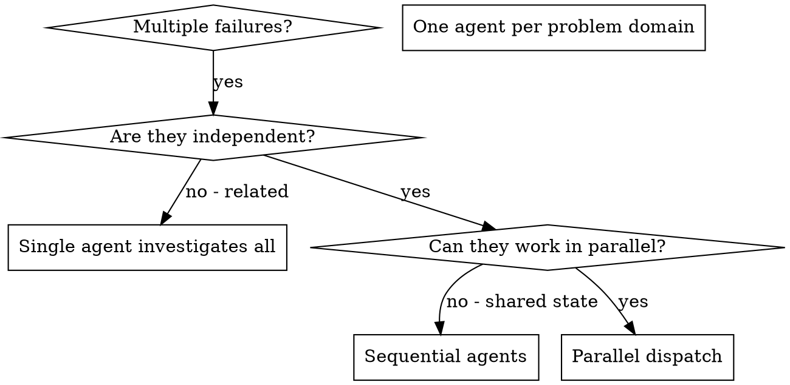

# Параллельный запуск агентов

## Обзор

Ты поручаешь задачи специализированным агентам с изолированным контекстом. Точно формулируя их инструкции и контекст, ты помогаешь им сосредоточиться и добиться результата. Агенты не должны наследовать контекст и историю твоей сессии — ты сами формируешь то, что им нужно. Заодно это сохраняет твой контекст для координации работы.

Когда есть несколько несвязанных сбоев (разные файлы тестов, разные подсистемы, разные ошибки), последовательный разбор тратит время. Каждый разбор независим и может идти параллельно.

**Главный принцип:** по одному агенту на независимую предметную область. Пусть они работают одновременно.

## Когда использовать



**Используй, когда:**

- три и более файлов тестов падают по разным причинам
- несколько подсистем сломаны независимо друг от друга
- каждую проблему можно понять без контекста остальных
- между разборами нет общего состояния

**Не используй, когда:**

- сбои связаны (исправление одного может исправить остальные)
- нужно понимать состояние системы целиком
- агенты будут мешать друг другу

## Схема работы

### 1. Определи независимые области

Сгруппируй сбои по тому, что именно сломано:

- тесты файла A: поток подтверждения инструментов
- тесты файла B: поведение при завершении пакета
- тесты файла C: работа прерывания

Каждая область независима: исправление подтверждения инструментов не влияет на тесты прерывания.

### 2. Составь сфокусированные задачи для агентов

Каждый агент получает:

- **конкретную область:** один файл тестов или подсистему
- **ясную цель:** сделать так, чтобы эти тесты проходил
- **ограничения:** не менять другой код
- **ожидаемый результат:** краткий отчёт о найденном и исправленном

### 3. Запусти параллельно

Отправь все три запуска субагентов в одном ответе — они выполнятся параллельно:

```text
Субагент (general-purpose): «Исправь сбои в agent-tool-abort.test.ts»
Субагент (general-purpose): «Исправь сбои в batch-completion-behavior.test.ts»
Субагент (general-purpose): «Исправь сбои в tool-approval-race-conditions.test.ts»
# Все три работают одновременно.
```

Несколько запусков в одном ответе = параллельное выполнение. По одному за ответ = последовательное.

### 4. Проверь и объедини

Когда агенты вернутся:

- прочитай каждый отчёт
- убедись, что исправления не конфликтуют
- запусти полный набор тестов
- объедини все изменения

## Структура задания агенту

Хорошее задание агенту:

1. **сфокусировано** — одна ясная предметная область
2. **самодостаточно** — содержит весь контекст для понимания проблемы
3. **конкретно по результату** — что именно агент должен вернуть

```markdown
Исправь три падающих теста в src/agents/agent-tool-abort.test.ts:

1. «should abort tool with partial output capture» — ожидает 'interrupted at' в сообщении
2. «should handle mixed completed and aborted tools» — быстрый инструмент прерван вместо завершения
3. «should properly track pendingToolCount» — ожидает 3 результата, получает 0

Это проблемы синхронизации и гонок. Твоя задача:

1. Прочитать файл тестов и понять, что проверяет каждый тест
2. Найти корневую причину — проблемы синхронизации или настоящие ошибки?
3. Исправить так:
   - заменить произвольные таймауты на ожидание по событиям
   - исправить ошибки в реализации прерывания, если они найдены
   - скорректировать ожидания тестов, если проверяемое поведение изменилось

НЕ увеличивай таймауты — найди настоящую причину.

Верни: краткий отчёт о найденном и исправленном.
```

## Частые ошибки

**❌ Слишком широко:** «Исправь все тесты» — агент теряется
**✅ Конкретно:** «Исправь agent-tool-abort.test.ts» — понятная область

**❌ Без контекста:** «Исправь гонку» — агент не знает где
**✅ С контекстом:** вставь сообщения об ошибках и имена тестов

**❌ Без ограничений:** агент может отрефакторить всё
**✅ С ограничениями:** «НЕ меняй рабочий код» или «Исправляй только тесты»

**❌ Размытый результат:** «Исправь» — ты не узнаешь, что изменилось
**✅ Конкретно:** «Верни отчёт о корневой причине и изменениях»

## Когда НЕ использовать

**Связанные сбои:** исправление одного может исправить остальные — сначала разберись вместе
**Нужен полный контекст:** для понимания нужно видеть систему целиком
**Поисковая отладка:** ты ещё не знаешь, что сломано
**Общее состояние:** агенты будут мешать друг другу (правят те же файлы, используют те же ресурсы)

## Реальный пример из сессии

**Ситуация:** шесть падающих тестов в трёх файлах после крупного рефакторинга

**Сбои:**

- agent-tool-abort.test.ts: 3 сбоя (проблемы синхронизации)
- batch-completion-behavior.test.ts: 2 сбоя (инструменты не выполняются)
- tool-approval-race-conditions.test.ts: 1 сбой (число выполнений = 0)

**Решение:** независимые области — логика прерывания отдельно от завершения пакета, отдельно от гонок

**Запуск:**

```
Агент 1 → исправить agent-tool-abort.test.ts
Агент 2 → исправить batch-completion-behavior.test.ts
Агент 3 → исправить tool-approval-race-conditions.test.ts
```

**Результаты:**

- Агент 1: заменил таймауты на ожидание по событиям
- Агент 2: исправил ошибку в структуре событий (threadId не на месте)
- Агент 3: добавил ожидание завершения асинхронного выполнения инструмента

**Объединение:** все исправления независимы, конфликтов нет, полный набор тестов зелёный

## Проверка

После возврата агентов:

1. **Прочитай каждый отчёт** — пойми, что изменилось
2. **Проверь конфликты** — не правили ли агенты один и тот же код?
3. **Запусти полный набор** — убедись, что исправления работают вместе
4. **Выборочно проверь** — агенты могут систематически ошибаться
