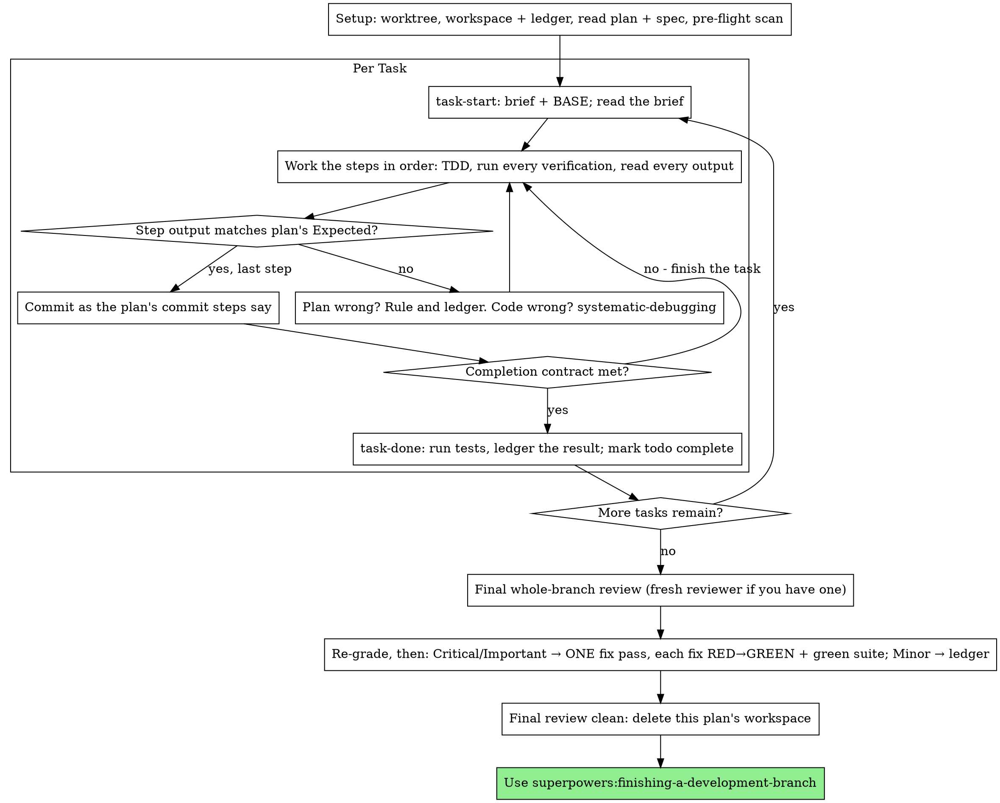

# Выполнение планов

Выполняй план сами, задача за задачей, в этой сессии: без субагента-исполнителя
на каждую задачу и без ревьюера на каждую задачу. Одна проверка всей ветки в
конце со свежим контекстом.

**Зачем на месте:** разработка через субагентов платит за свежего исполнителя и
свежего ревьюера на каждой задаче, и каждый заново читает проект с нуля.
Выполнение на месте платит за один контекст (твой) плюс одного ревьюера в конце.
Чем оно расплачивается — свежим контекстом на задачу и второй парой глаз на
задачу. Этот навык сохраняет то, что давали эти две вещи, другими средствами:
задание заменяет спецификацию, журнал заменяет память, TDD служит пропуском на
каждую задачу, а итоговый ревьюер — вторая пара глаз.

**Главный принцип:** план уже всё продумал. Выполняй его точно, доказывай
каждый шаг тестом, который ты видел падающим и затем проходящим, и оставляй
запись, которая переживёт твою забывчивость.

**Повествование:** между вызовами инструментов произноси не больше одной
короткой строки — запись несут журнал и результаты инструментов.

**Непрерывное выполнение:** не останавливайся, чтобы свериться с собеседником
между задачами. Он выбрал выполнение на месте, чтобы меньше тратить, а не чтобы
отвечать на «продолжать ли?» после каждой задачи. Выполни все задачи плана, не
останавливаясь.

**Решения вместо остановок.** Конфликты, неоднозначности, изъяны плана —
решай их. Спецификация связывает, план — её аргумент, а твоё суждение решает
то, чего не решает ни то, ни другое. Записывай каждое решение в журнал как
`Решение: <что решил> — <почему> — <во что обойдётся, если ошибка>`, и иди
дальше. Отклонение от плана без записи в журнале — это решение, принятое втайне.

Останавливают тебя четыре вещи, и только они: необратимая или разрушительная
операция; действие, чувствительное к безопасности; побочный эффект вне этого
worktree, о котором принято спрашивать заранее (слияние, пуш в общую ветку,
публикация); и план, сломанный настолько, что любой путь вперёд — догадка. В
этих случаях остановись и спроси.

## Когда использовать

- у тебя есть план от `superpowers:writing-plans`, и при передаче собеседник
  выбрал выполнение на месте;
- в твоей среде нет инструмента субагентов (см. справочники по платформам в
  `../using-superpowers/references/`). Никогда не выдумывай запуск субагента;
  выполняй план здесь;
- задачи в основном независимы — то же условие, что и у
  `superpowers:subagent-driven-development`.

Полностью описанный план превращает выполнение на месте в переписывание плюс
тестирование: оно хорошо идёт на модели среднего уровня, а единственное место,
где самая сильная модель оправдывает свою цену, — итоговая проверка, которую
этот навык запускает отдельно. Скажи об этом собеседнику, когда он выбирает
выполнение на месте.

Предпочитай `superpowers:subagent-driven-development`, если собеседник хочет
проверку на каждой задаче или план настолько длинный, что его поздние задачи
пойдут на сжатом контексте. Выполнение на месте по длинному плану всё равно
работает — восстановление обеспечивает журнал, — но последним задачам достаётся
меньше тебя.

## Процесс

## Подготовка

Убедись, что работа идёт в изолированной рабочей области: используй
`superpowers:using-git-worktrees`, чтобы создать её или проверить существующую.
Никогда не начинай реализацию в ветке `main` или `master` без явного согласия
собеседника.

Память разговора не переживает сжатие. Исполнитель на месте, потерявший место,
заново реализует задачи, коммиты которых уже существуют, — тот же провал, что у
координатора, повторно запускающего задачи, только оплаченный твоим контекстом.
Веди прогресс в файле журнала, а не только в списке задач. Список задач в
среде — живой вид; журнал — запись.

Рабочая область и журнал общие с `superpowers:subagent-driven-development` —
тот же каталог, тот же формат, — поэтому план может сменить исполнителя на ходу,
и новый продолжит с того же журнала.

- У каждого плана своя рабочая область: в начале навыка запусти
  `../subagent-driven-development/scripts/sdd-workspace PLAN_FILE` по
  абсолютному пути из рабочего дерева, в котором выполняешь, — скрипт напечатает
  игнорируемый Git каталог плана (`<repo-root>/.superpowers/sdd/<plan-basename>/`),
  дом для всех артефактов ЭТОГО плана: журнала, заданий, пакетов проверки.
  Каталог другого плана тебе читать и писать нельзя.
- Проверь журнал этого плана в `<workspace>/progress.md`. Если его первая
  строка называет твой файл плана, задачи со строкой `Task <N>: complete`
  СДЕЛАНЫ — не повторяй их; продолжай с первой задачи без такой строки. Их
  коммиты есть в Git, даже когда твой контекст уже не помнит, как их делал: после
  сжатия доверяй журналу и `git log`, а не своей памяти. Журнал, первая строка
  которого называет другой файл плана, — это прогресс другого плана: оставь
  его и начни свой, с нуля.
- Создай журнал, первой строкой указав его принадлежность:
  `# SDD ledger — plan: <plan file path>`.
- `git clean -fdx` уничтожит рабочую область (это игнорируемый Git черновик);
  если это случилось, восстанавливай по `git log`.

Прочитай план один раз, отметь его контекст и глобальные ограничения и
создай задачу в списке на каждый пункт. Если план называет спецификацию,
прочитай и её: спецификация — та власть, от которой рассуждает план, и
конфликты внутри плана решаются по ней. План без доступной спецификации получает
запись в журнале об этом — решения, принятые без неё, предварительны.

**ОБЯЗАТЕЛЬНЫЙ ПОДНАВЫК:** загрузи `superpowers:test-driven-development`
сейчас, до задачи 1. Он управляет каждым шагом каждой задачи ниже; план, шаги
которого уже говорят «сначала напиши падающий тест», не освобождает тебя от
чтения.

До задачи 1 просмотри план на конфликты между задачами. Блоки интерфейсов
плана показывают, где искать: для каждой задачи, которая потребляет то, что даёт
более ранняя задача, — одна строка журнала: обе задачи, что одна даёт против
того, что потребляет другая, и что ты нашёл. Задачи, не имеющие общего, строки
не получают; план, задачи которого не имеют общего, получает единственную строку
`Pre-flight: no shared interfaces`. Реши каждый конфликт, вскрытый строкой,
считая спецификацию связывающей, запиши решение рядом со строкой и начинай
задачу 1. Текст самой задачи проверяется, когда ты читаешь её задание, а не
здесь.

## Цикл задачи

Всё, что ты печатаешь, и каждый результат инструмента остаются в твоём контексте
до конца сессии. Перенаправляй длинный вывод тестов в файл в рабочей области
и читай его хвост; читай задание, а не весь план.

### 1. Возьми задачу

- Запусти `scripts/task-start PLAN_FILE N` этого навыка по абсолютному пути из
  рабочего дерева, в котором выполняешь. Скрипт печатает путь к заданию и BASE
  (коммит, от которого отрезается диапазон задачи) одним вызовом.
  Читай задание для каждой задачи, включая те, что помнишь с подготовки: то,
  что ты помнишь, — пересказ, а в задании точные значения, сигнатуры и случаи
  тестов.
- Отметь задачу в списке как выполняемую.

Каждый вызов инструмента — это ход, который заново читает весь твой контекст.
Учётная работа идёт вместе с работой: дописка в журнал в том же вызове, что и
коммит, никогда отдельным вызовом.

### 2. Проработай шаги

Шаги плана уже идут в порядке «красный — зелёный»; следуй им в этом порядке под
управлением `superpowers:test-driven-development`, загруженного на подготовке.
Код шага с тестом пишется первым и запускается первым. Видеть его падение — это
шаг, а не формальность: тест, который проходит до появления реализации, — это
находка о тесте.

У каждого шага, запускающего команду, есть строка `Expected:`. Запусти команду,
прочитай вывод и сравни. Три исхода:

- **Совпало.** Следующий шаг.
- **Код неверен.** Используй `superpowers:systematic-debugging`. Найди
  причину; никогда не латай симптом, чтобы вывод шага совпал.
- **План неверен** — шаг противоречит спецификации, интерфейс из более ранней
  задачи не совпадает с тем, что потребляет эта, команда не может работать.
  Реши наименьшим изменением, удовлетворяющим спецификацию, запиши в журнал
  как `Task <N>: Решение: <находка> — <что решил и почему>` и продолжай.
  Решение переносится, а не запоминается: поздние задачи, затрагивающие тот же
  интерфейс, читают его из журнала.

Коммить так, как говорят шаги коммита плана. Задача из нескольких коммитов
допустима; BASE — то, от чего отрезается диапазон проверки, никогда не `HEAD~1`.

### 3. Договор о завершении

Прежде чем появится строка задачи в журнале, в этой сессии должно быть истинно
всё перечисленное, с доказательствами — а не выведено из того, что дифф выглядит
правильно:

- каждый тест, названный в задании, существует и запускался в этой задаче, и ты
  прочитал вывод;
- итоговый прогон тестов задачи прошёл — `task-done` и есть этот прогон, он
  записывает команду и результат в строку журнала;
- каждая строка `Expected:` из задания сверена с настоящим выводом;
- у каждого отклонения от задания есть строка `Решение:` в журнале.

**ОБЯЗАТЕЛЬНЫЙ ПОДНАВЫК:** `superpowers:verification-before-completion` управляет
заявлением. Если чего-то не хватает, задача не завершена: заверши её.

### 4. Заверши задачу

Запусти `scripts/task-done PLAN_FILE N BASE -- <test command>` этого навыка по
абсолютному пути из рабочего дерева, в котором выполняешь, с командой тестов,
которую задание называет для всей задачи. Скрипт запускает тесты, сохраняет
полный вывод в рабочей области, печатает хвост и — только если они прошёл —
дописывает в журнал строку завершения:

`Task <N>: complete (commits <base7>..<head7>, tests: <command> → <result>)`

Неудачный прогон ничего не записывает; задача не завершена. Когда запись
появилась, отметь задачу выполненной и бери следующую.

## Итоговая проверка

Запусти `../subagent-driven-development/scripts/review-package PLAN_FILE MERGE_BASE HEAD`
по абсолютному пути из рабочего дерева, в котором выполняешь (MERGE_BASE —
коммит, от которого началась ветка, например `git merge-base main HEAD`), и
проверяй по файлу, который он напечатает.

**С инструментом субагентов:** запусти ревьюера на самой сильной доступной
модели — проверка всей ветки это задача на суждение — по шаблону
[code-reviewer.md](../requesting-code-review/code-reviewer.md) из
`superpowers:requesting-code-review`, передав путь к пакету, пути к плану и
спецификации, раздел плана «На что смотреть при проверке» дословно, если он
есть (классы входных данных и режимы отказа, которые не проверяют тесты плана, —
ревьюер проверяет каждый намеренно), и указание на строки `Решение:` в журнале,
чтобы он мог взвесить принятые тобой решения. Указывай модель явно; пропущенная
модель наследует модель сессии, а она может быть не самой сильной. Это
единственный свежий контекст, который покупает весь прогон. Не пропускай его и
не заменяй своим чтением диффа.

**Без инструмента субагентов:** прочитай `code-reviewer.md` и проведи эту
проверку сами по пакету, отдельным проходом после строки журнала последней
задачи. Запиши в журнал `Final review: self-review (no subagent tool)` и
скажи об этом в итоговом сообщении: самопроверка автора слабее свежего
ревьюера, и собеседник решает, достаточно ли этого до слияния.

Разложи находки до того, как что-то по ним делать. Метки важности от
ревьюера — совет; пропуском распоряжаесь ты. Его список «Воздержался от
суждения» тоже твой: каждая строка там — решение, которое принимаешь и
записываешь ты, точно как конфликт плана — `Final: Решение: <поведение, которое
ревьюер отложил> — <что получит разумный человек, пользующийся этой программой, и
почему это остаётся или почему теперь это находка> — <во что обойдётся ошибка>`.
Сначала переоцени важность по эффекту: спецификация — документ о замысле, и
важность находки определяется тем, что получит разумный человек, пользующийся
программой, если это выйдет в выпуск, а не тем, называет ли спецификация вход,
который это вызывает; ревьюер, поставивший находке незначительную важность
из-за молчания спецификации, оценил спецификацию, а не эффект. Затем:

- **Критические и важные** попадают в проход исправлений.
- **Незначительные** идут в журнал как `Final: minor (deferred): <одна строка>` и
  в итоговое сообщение в раздел «Отложенные мелочи». Мелочи никогда не попадают
  в проход исправлений и никогда не становятся решениями: решение — это выбор о
  конфликте, а не заметка о том, что ты отклонил предложение о полировке.

Исправь критические и важные находки сами — здесь ты исполнитель — за ОДИН
проход. Каждое исправление подтверждается через TDD, а не вторым ревьюером:
напиши тест, воспроизводящий находку, посмотри, как он падает, сделай так,
чтобы он прошёл, затем запусти весь набор. Запиши каждое в журнал как
`Final: fixed <finding> — <test name> RED→GREEN, suite <N>/<N>`. Исправление без
теста, который сначала упал, не подтверждено; набор, не зелёный после прохода,
означает, что проход не закончен. Не запускай повторную проверку: она заново
прочитает дифф, на который покрывающие тесты уже ответил «учтено», а прогон
набора — «ничего не сломалось».

Находка, которую ты решил не исправлять, — это решение:
`Final: Решение: <находка> — <почему код остаётся> — <во что обойдётся ошибка>` —
и оно попадает к собеседнику в список решений. Второго прохода исправлений нет.

## Завершение

Прежде чем что-либо удалять, собери все строки журнала со словом `Решение:` в
итоговое сообщение в раздел «Принятые мной решения» в том порядке, в котором их
принимал, каждое с ценой ошибки, и все строки `minor (deferred)` в раздел
«Отложенные мелочи». Оба списка исчерпывающие. Итоговое сообщение — единственное
место, где решения, принятые тобой от имени собеседника, и находки, по которым ты
решил не действовать, доходят до него.

Когда итоговая проверка чиста и её исправления закоммичены, удали каталог
рабочей области этого плана — теперь запись — это история Git. Соседние каталоги
принадлежат другим планам; не трогай их.

Используй `superpowers:finishing-a-development-branch`.

## Частые оправдания

| Оправдание | Действительность |
|--------|---------|
| «Я помню, что сказано в задаче N» | Ты помнишь пересказ. В задании точные значения. Прочитай его. |
| «Код в плане верный, можно не смотреть, как тест падает» | Тест, которого ты не видел падающим, ничего не доказывает. Это один шаг. Запусти. |
| «Запущу весь набор в конце вместо каждого шага» | Прогоны по шагам — то, откуда ты узнаешь, какой шаг сломал. Прогон в конце задачи — договор, а не замена. |
| «Здесь план неверен, сделаю как правильно» | Сделай как правильно и запиши решение в журнал. Отклонение без записи — решение, принятое втайне. |
| «Запишу строки журнала через несколько задач» | Сжатие не ждёт удобного момента. Одна строка на задачу, в том же сообщении, что и коммит. |
| «Дай сверюсь перед следующей задачей» | Он выбрал выполнение на месте, чтобы меньше тратить. Запросы о прогрессе тратят его время. Останавливают только четыре случая. |
| «Я внимательно прочитал свой дифф, итоговый ревьюер избыточен» | Тот же автор, те же слепые зоны. Ревьюер — единственный свежий контекст, который покупает прогон. |
| «Тесты должны проходить, изменение было пустяковым» | «Должно» — не доказательство. Договор требует команду и её вывод. |
| «Субагенты медленные и дорогие, пропущу и итоговую проверку» | Выполнение на месте уже убрало ревьюеров на каждой задаче. Одна проверка всей ветки — нижняя граница, а не верхняя. |
| «Ревьюер сказал „незначительно“, значит незначительно» | Метка оценила молчание спецификации. Оценивай то, что получит человек. Сначала переоцени, потом решай. |
| «Исправление очевидно, падающий тест не нужен» | Падающий тест — единственное доказательство, что находка была настоящей и теперь её нет. Без него у тебя дифф и надежда. |
| «Заодно исправлю и мелочи» | Каждая исправленная мелочь — это тест, исправление и прогон набора, о которых собеседник не просил. Запиши их; решает он. |
