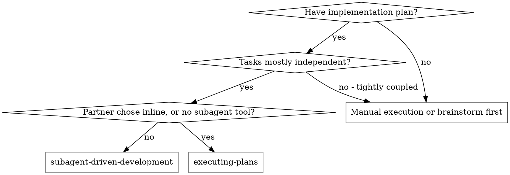
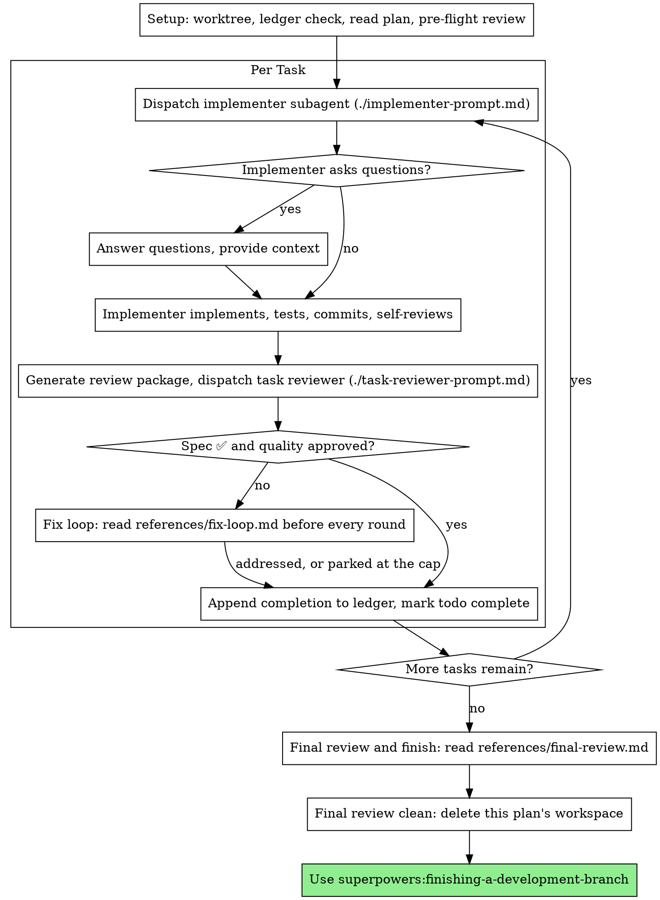

# Разработка через субагентов

Выполняй план, запуская свежего субагента-исполнителя на каждую задачу,
проверку задачи (соответствие спецификации и качество кода) после каждой и
широкую проверку всей ветки в конце.

**Зачем субагенты:** ты поручаешь задачи специализированным агентам с
изолированным контекстом. Точно формулируя их инструкции и контекст, ты помогаешь
им сосредоточиться и добиться результата. Они не должны наследовать контекст и
историю твоей сессии — ты сами формируешь то, что им нужно. Заодно это сохраняет
твой контекст для координации работы.

**Главный принцип:** свежий субагент на задачу + проверка задачи (спецификация и
качество) + широкая итоговая проверка = высокое качество и быстрые итерации.

**Повествование:** между вызовами инструментов произноси не больше одной
короткой строки — запись несут журнал и результаты инструментов.

**Непрерывное выполнение:** не останавливайся, чтобы свериться с собеседником
между задачами. Выполни все задачи плана, не останавливаясь. Остановиться можно
только по четырём причинам, названным ниже, или когда все задачи выполнены.
Запросы «продолжать ли?» и сводки о прогрессе тратят его время — он попросил
выполнить план, так выполняй.

**Решения вместо остановок.** Идущий план не ждёт человека. Конфликты,
неоднозначности, изъяны плана, предел, который ты хотел бы превысить, — решай
их. Спецификация связывает, план — её аргумент, а твоё суждение решает то, чего
не решает ни то, ни другое. Записывай каждое решение в журнал как
`Решение: <что решил> — <почему> — <во что обойдётся, если ошибка>`, и иди
дальше. Ошибочное решение стоит переделки, которую собеседник видит и может
отменить; сессия, замершая на вопросе, стоит ему целого дня и не даёт ничего.

Останавливают тебя четыре вещи, и только они: необратимая или разрушительная
операция; действие, чувствительное к безопасности; побочный эффект вне этого
worktree, о котором принято спрашивать заранее (слияние, пуш в общую ветку,
публикация); и план, сломанный настолько, что любой путь вперёд — догадка. В этих
случаях остановись и спроси.

## Когда использовать

**Против выполнения на месте:**

- свежий субагент на задачу (без загрязнения контекста) вместо одного контекста,
  делающего все задачи;
- проверка после каждой задачи (соответствие спецификации и качество кода)
  вместо проверки только в конце;
- стоит свежего контекста на задачу и на проверку; выполнение на месте стоит
  одного контекста плюс одного итогового ревьюера;
- оба идут в этой сессии, делят одну рабочую область плана и журнал и никогда не
  останавливаются между задачами.

## Процесс

## Подготовка

Убедись, что работа идёт в изолированной рабочей области: используй
`superpowers:using-git-worktrees`, чтобы создать её или проверить существующую.
Никогда не начинай реализацию в ветке `main` или `master` без явного согласия
собеседника.

Память разговора не переживает сжатие. В настоящих сессиях координаторы,
потерявшие место, заново запускал целые выполненные последовательности задач —
самый дорогой наблюдавшийся провал. Веди прогресс в файле журнала, а не только
в списке задач.

- У каждого плана своя рабочая область: в начале навыка запусти
  `bash scripts/sdd-workspace PLAN_FILE` этого навыка по абсолютному пути из
  рабочего дерева, в котором выполняешь, — скрипт напечатает игнорируемый Git
  каталог плана (внутри `<repo-root>/.superpowers/sdd/`), дом для всех артефактов
  ЭТОГО плана: журнала, заданий, отчётов, пакетов проверки. Каталог другого плана
  тебе читать и писать нельзя.
- Проверь журнал этого плана в `<workspace>/progress.md`. Если он есть,
  прочитай [references/resuming.md](references/resuming.md) прежде всего
  остального: там сказано, чей это журнал и откуда продолжать.
- Создай журнал, первой строкой указав его принадлежность:
  `# SDD ledger — plan: <plan file path>`.
- Журнал — твоя карта восстановления: названные в нём коммиты есть в Git, даже
  когда твой контекст уже не помнит, как их создавал. После сжатия доверяй
  журналу и `git log`, а не своей памяти.
- `git clean -fdx` уничтожит рабочую область (это игнорируемый Git черновик);
  если это случилось, восстанавливай по `git log`.

Прочитай план один раз, отметь его контекст и глобальные ограничения и
создай задачу в списке на каждый пункт. Если план называет спецификацию,
прочитай и её: спецификация — та власть, от которой рассуждает план, и
конфликты внутри плана решаются по ней. План без доступной спецификации получает
запись в журнале об этом — решения, принятые без неё, предварительны.

Прежде чем запускать задачу 1, прочитай [references/preflight.md](references/preflight.md)
и выполни описанный там поиск конфликтов. Его таблица и решения идут в журнал.

## Выбор модели

Используй наименее сильную модель, которая справляется с каждой ролью, чтобы
экономить и ускорять работу.

**Механические задачи реализации** (изолированные функции, ясные спецификации,
1–2 файла): быстрая и дешёвая модель. Большинство задач реализации механические,
когда план хорошо описан.

**Задачи интеграции и суждения** (согласование нескольких файлов, поиск образцов,
отладка): стандартная модель.

**Задачи архитектуры и проектирования**: самая сильная доступная модель.
Итоговая проверка всей ветки — одна из таких; запускай её на самой сильной
доступной модели, а не на модели сессии по умолчанию.

**Задачи проверки**: выбирай модель тем же суждением, соразмерно размеру,
сложности и риску диффа. Небольшой механический дифф не требует самой сильной
модели; тонкое изменение с конкурентностью — требует. Ограниченные повторные
проверки небольших диффов исправлений берут дешёвый или средний уровень.

**Повышение уровня в цикле исправлений (раунды 4–5)**: модель как минимум на
уровень выше исполнителя, который застрял.

**Всегда указывай модель явно при запуске субагента.** Пропущенная модель
наследует модель твоей сессии — часто самую сильную и дорогую, — что молча
обесценивает весь этот раздел.

**Число ходов важнее цены токенов.** Время и стоимость контекста растут от того,
сколько ходов делает субагент, а самые дешёвые модели регулярно делают в 2–3
раза больше ходов на многошаговой работе — в итоге дороже. Средний уровень —
нижняя граница для ревьюеров и для исполнителей, работающих по прозаическим
описаниям. Когда текст плана для задачи содержит полный код, реализация — это
переписывание плюс тестирование: для такого исполнителя бери самый дешёвый
уровень. Механические исправления в одном файле тоже берут самый дешёвый уровень.

**Признаки сложности задачи (задачи реализации):**

- 1–2 файла с полной спецификацией → дешёвая модель
- несколько файлов с заботами интеграции → стандартная модель
- нужны проектные суждения или широкое понимание проекта → самая сильная модель

## Цикл задачи

**Мелкая однотипная работа:** когда план перечисляет несколько мелких правок
одного вида по файлам, прочитай [references/batching.md](references/batching.md)
до их запуска.

Всё, что ты вставляешь в задание на запуск, и всё, что печатает субагент, остаётся
в твоём контексте до конца сессии и перечитывается на каждом следующем ходе.
Передавай артефакты файлами.

**Ожидание запущенных субагентов:** никогда не опрашивай интерфейс ожидания
короткими тайм-аутами и не сиди в одном молчаливом бесконечном ожидании. Пока
есть местная работа — обновления журнала, упаковка следующей проверки, чтение
отчётов, — работай; результаты детей приходят сами. Когда ты действительно
простаиваешь, ждёшь ограниченными отрезками (пять-десять минут, где платформа
позволяет), и между отрезками публикуй одну строку состояния и сверяй живых
детей: перечисли их и догони тех, кто завершился без отчёта. Ограниченный
отрезок сохраняет почти всю эффективность долгого ожидания и при этом гарантирует,
что застрявший или потерянный ребёнок будет замечен через минуты, а не в конце
сессии.

### 1. Запусти исполнителя

Запиши BASE (`git rev-parse HEAD`) до запуска — он нужен пакету проверки и
диффам раундов исправлений.

- **Задание на задачу:** прежде чем запускать исполнителя, выполни
  `bash scripts/task-brief PLAN_FILE N` этого навыка по абсолютному пути из
  рабочего дерева, в котором выполняешь, — скрипт извлечёт полный текст задачи в
  файл с уникальным именем и напечатает путь. Составь запуск так, чтобы задание
  оставалось единственным источником требований. В запуске должно быть: (1) одна
  строка о том, где эта задача в проекте; (2) путь к заданию с пояснением
  «прочитай это первым — это твои требования, с точными значениями, которые
  нужно использовать дословно»; (3) интерфейсы и решения из более ранних задач,
  которых задание знать не может; (4) твоё разрешение любой неоднозначности,
  которую ты заметил в задании; (5) путь к файлу отчёта и договор об отчёте.
  Точные значения (числа, магические строки, сигнатуры, случаи тестов) есть
  только в задании. Никогда не заставляй субагента читать весь файл плана.
- **Файл отчёта:** назови файл отчёта исполнителя по заданию (задание
  `…/task-N-brief.md` → отчёт `…/task-N-report.md`) и укажи его в задании на
  запуск. Исполнитель пишет туда полный отчёт и возвращает только статус,
  коммиты, одну строку о тестах и заботы.
- Задание на запуск описывает одну задачу, а не историю сессии. Не вставляй в
  поздние запуски накопленные сводки прошлых задач («состояние после задач 1–3») —
  в настоящей сессии запуск достиг 42 тысяч знаков, из которых 99% была вставленная
  история. Свежему субагенту нужны его задача, интерфейсы, которые она
  затрагивает, и глобальные ограничения. Ничего больше.
- Запуск несёт договор «без субагентов» (он есть в шаблоне исполнителя):
  исполнитель никогда не запускает субагентов — ни помощников, и никогда
  ревьюера. Проверка приходит от тебя, после отчёта. В настоящих сессиях каждый
  ревьюер, которого породил работник, дублировал проверку задачи, которую
  координатор всё равно запускал, — целое лишнее место проверки на задачу.
- Если более ранняя задача оставила отложенную находку в области, которую
  затрагивает эта задача, неси в запуске указатель на эту запись журнала.
- Запиши идентификатор агента-исполнителя из результата запуска — раунды
  исправлений 1–3 продолжают этого агента.
- Никогда не запускай несколько субагентов-исполнителей параллельно
  (конфликты).

Шаблон: [implementer-prompt.md](implementer-prompt.md)

### 2. Обработай отчёт

Субагенты-исполнители сообщают один из четырёх статусов. Обрабатывай каждый
подходяще:

**DONE:** сформируй пакет проверки (`bash scripts/review-package PLAN_FILE BASE HEAD`
по абсолютному пути из рабочего дерева, в котором выполняешь, — скрипт напечатает
путь к записанному файлу; BASE — коммит, записанный до запуска исполнителя,
никогда не `HEAD~1`, который молча отбросит все коммиты задачи, кроме последнего),
затем запусти ревьюера задачи с напечатанным путём.

**Любой другой статус** (DONE_WITH_CONCERNS, NEEDS_CONTEXT, BLOCKED): прочитай
[references/handling-reports.md](references/handling-reports.md) и следуй ему
каждый раз, когда получаешь такой статус.

Если исполнитель задаёт вопросы — до начала или посреди задачи — отвечай ясно и
полно, дай дополнительный контекст, если нужно, и не торопи его в реализацию.

### 3. Проверь задачу

Проверки задач — пропуска в пределах задачи. Широкая проверка происходит один раз,
на итоговой проверке всей ветки. Никогда не пропускай проверку задачи и никогда
не принимай отчёт без одного из вердиктов — нужны и соответствие спецификации, и
качество задачи. Самопроверка исполнителя никогда не заменяет проверку задачи;
нужны обе.

- Передай ревьюеру его дифф файлом: выполни
  `bash scripts/review-package PLAN_FILE BASE HEAD` этого навыка по абсолютному
  пути из рабочего дерева, в котором выполняешь, и передай ревьюеру
  напечатанный путь (или, без bash: `git log --oneline`, `git diff --stat` и
  `git diff -U10` по диапазону, перенаправленные в один файл с уникальным именем).
  Вывод никогда не попадает в твой контекст, а ревьюер видит список коммитов,
  сводку изменений и полный дифф с контекстом одним чтением файла. Используй
  BASE, записанный до запуска исполнителя, — никогда не `HEAD~1`, который молча
  обрежет задачи из нескольких коммитов. Никогда не запускай ревьюера задачи без
  файла диффа.
- **Что получает ревьюер:** ревьюер задачи получает три пути — тот же файл
  задания, файл отчёта и пакет проверки — плюс глобальные ограничения, которые
  связывают задачу.
- Блок глобальных ограничений, который ты передаешь ревьюеру, — его линза
  внимания. Копируй связывающие требования дословно из раздела глобальных
  ограничений плана или из спецификации: точные значения, точные форматы и
  заявленные отношения между компонентами («та же раскладка, что у X», «совпадает
  с Y»). Шаблон ревьюера уже несёт процессные правила (YAGNI, гигиена тестов,
  метод проверки) — блок ограничений нужен для того, что требует спецификация
  ЭТОГО проекта.
- Не добавляй открытые указания вроде «проверь все использования» или «прогони
  тесты на гонки, если полезно» без конкретной причины, связанной с задачей.
- Не проси ревьюера заново запускать тесты, которые исполнитель уже запускал на
  том же коде: отчёт исполнителя несёт доказательства тестов.
- Не предрешай находки за ревьюера — никогда не указывай ревьюеру игнорировать
  или не помечать конкретную проблему. Если ты считаешь, что находка будет ложной,
  дай ревьюеру её поднять и разбери её в цикле проверки. Если в твоём задании
  есть «не помечай», «не считай X дефектом», «не более чем незначительно» или
  «план так выбрал» — остановись: ты предрешаешь, обычно чтобы избавить себя от
  цикла проверки.

Если ревьюер сообщает о пунктах «⚠️ Нельзя проверить по диффу», прочитай
[references/cannot-verify.md](references/cannot-verify.md) до того, как отмети
задачу завершённой.

Шаблон: [task-reviewer-prompt.md](task-reviewer-prompt.md)

### 4. Цикл исправлений

Цикл запускается, когда проверка сообщает о несоответствии спецификации, любой
критической или важной находке либо о пункте ⚠️, который ты подтвердил как
настоящий пробел.

Когда он запускается, прочитай [references/fix-loop.md](references/fix-loop.md)
и следуй ему. Перечитывай его перед каждым раундом, даже если читал раньше в
этой сессии: там предел раундов, размыкатель и строка журнала, которую пишет
каждый раунд, а твоя память о нём не переживёт сжатия.

### 5. Заверши задачу

Когда проверка вернулась чистой — или каждая открытая находка отложена с решением
по достижении предела — допиши в журнал строку завершения в том же сообщении,
что и остальная учётная работа:

- `Task <N>: complete (commits <base7>..<head7>, review clean)`
- `Task <N>: complete (commits <base7>..<head7>, <K> parked)` после сработавшего
  размыкателя

Затем отметь задачу выполненной и иди дальше. Никогда не переходи к
следующей задаче, пока в проверке есть открытые критические или важные проблемы,
которые не исправлены и не отложены с решением по достижении предела.

## Итоговая проверка

Когда все задачи завершены, прочитай [references/final-review.md](references/final-review.md)
и следуй ему. Там проверка всей ветки, её единственная волна исправлений и то,
как завершить работу.

## Частые оправдания

| Оправдание | Действительность |
|--------|---------|
| «Соответствие спецификации почти полное» | Пробелы в спецификации, найденные ревьюером, = не сделано. Исправляй или дойди до предела и вынеси решение — других выходов нет. |
| «Исправлю сам, запуск субагента — накладные расходы» | Исправления координатора загрязняют твой контекст и пропускают проверку. Продолжи исполнителя. |
| «Ещё один раунд сойдётся» | За пределом раунды не сходятся — провал структурный. Вынеси решение и направь. |
| «Ревьюер всё равно найдёт что-то новое» | Ограниченные повторные проверки подтверждают исправления; они не могут бродить. Новые находки по нетронутому коду идут в журнал, а не в цикл. |
| «Эта находка явно ошибочна, отброшу её» | Ты выносишь решение только на пределе, и каждое решение — запись в журнале. Молчаливые отбрасывания запрещены. |
| «Исправление было мелким, пропущу повторную проверку» | Непроверенные исправления — так и попадают регрессии. Каждый раунд заканчивается ограниченной повторной проверкой. |
| «Проверки замедляют цикл» | Цикл без проверок — просто неподтверждённая суета. Проверки — тормоза и руль цикла. |
| «Ведение журнала — накладные расходы» | Журнал — то, что переживает сжатие. Координаторы без него заново запускал целые выполненные последовательности задач. |
| «Исполнитель породил своего ревьюера — бесплатная дополнительная надёжность» | Это дублирующее место проверки того же диффа; пропуск — проверка задачи. Ревьюер, порождённый работником, — дефект, а не строгость. |
