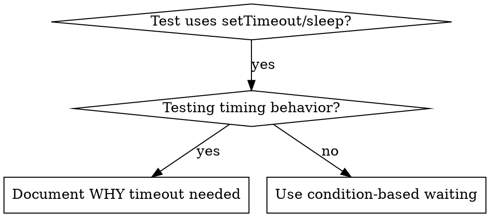

# Ожидание по условию

## Обзор

Нестабильные тесты часто угадывают время произвольными задержками. Это создаёт
гонки: тесты проходят на быстрых машинах, но падают под нагрузкой или в CI.

**Главный принцип:** ждёшь настоящее условие, которое тебя интересует, а не догадку
о том, сколько времени оно займёт.

## Когда использовать



**Используй, когда:**

- в тестах есть произвольные задержки (`setTimeout`, `sleep`, `time.sleep()`);
- тесты нестабильны (иногда проходят, под нагрузкой падают);
- тесты упираются в тайм-аут при параллельном запуске;
- нужно дождаться завершения асинхронных операций.

**Не используй, когда:**

- проверяется само поведение по времени (задержка нажатий, интервалы троттлинга);
- при использовании произвольного тайм-аута всегда документируй, ПОЧЕМУ он нужен.

## Основной образец

```typescript
// ❌ БЫЛО: угадываем время
await new Promise(r => setTimeout(r, 50));
const result = getResult();
expect(result).toBeDefined();

// ✅ СТАЛО: ждём условие
await waitFor(() => getResult() !== undefined);
const result = getResult();
expect(result).toBeDefined();
```

## Быстрые образцы

| Сценарий | Образец |
|----------|---------|
| Ждать событие | `waitFor(() => events.find(e => e.type === 'DONE'))` |
| Ждать состояние | `waitFor(() => machine.state === 'ready')` |
| Ждать количество | `waitFor(() => items.length >= 5)` |
| Ждать файл | `waitFor(() => fs.existsSync(path))` |
| Сложное условие | `waitFor(() => obj.ready && obj.value > 10)` |

## Реализация

Общая функция опроса:

```typescript
async function waitFor<T>(
  condition: () => T | undefined | null | false,
  description: string,
  timeoutMs = 5000
): Promise<T> {
  const startTime = Date.now();

  while (true) {
    const result = condition();
    if (result) return result;

    if (Date.now() - startTime > timeoutMs) {
      throw new Error(`Timeout waiting for ${description} after ${timeoutMs}ms`);
    }

    await new Promise(r => setTimeout(r, 10)); // Опрос каждые 10 мс
  }
}
```

Полную реализацию с предметными помощниками (`waitForEvent`, `waitForEventCount`,
`waitForEventMatch`) из настоящей сессии отладки смотришь в файле
`condition-based-waiting-example.ts` в этой директории.

## Частые ошибки

**❌ Слишком частый опрос:** `setTimeout(check, 1)` — тратит процессор
**✅ Исправление:** опрашивай каждые 10 мс

**❌ Нет тайм-аута:** цикл навсегда, если условие не выполнится
**✅ Исправление:** всегда добавляй тайм-аут с понятной ошибкой

**❌ Устаревшие данные:** состояние кэшируется до цикла
**✅ Исправление:** вызывай геттер внутри цикла для свежих данных

## Когда произвольный тайм-аут уместен

```typescript
// Инструмент срабатывает каждые 100 мс — нужно 2 срабатывания, чтобы проверить частичный вывод
await waitForEvent(manager, 'TOOL_STARTED'); // Сначала: ждём условие
await new Promise(r => setTimeout(r, 200));   // Затем: ждём поведение по времени
// 200 мс = 2 срабатывания с интервалом 100 мс — задокументировано и обосновано
```

**Требования:**

1. Сначала дождаться условия-триггера.
2. Опираться на известное время (не угадывать).
3. Прокомментировать, ПОЧЕМУ.

## Реальный эффект

Из сессии отладки (2025-10-03):

- исправлено 15 нестабильных тестов в трёх файлах;
- доля прохождений: 60% → 100%;
- время выполнения: на 40% быстрее;
- гонок больше нет.
