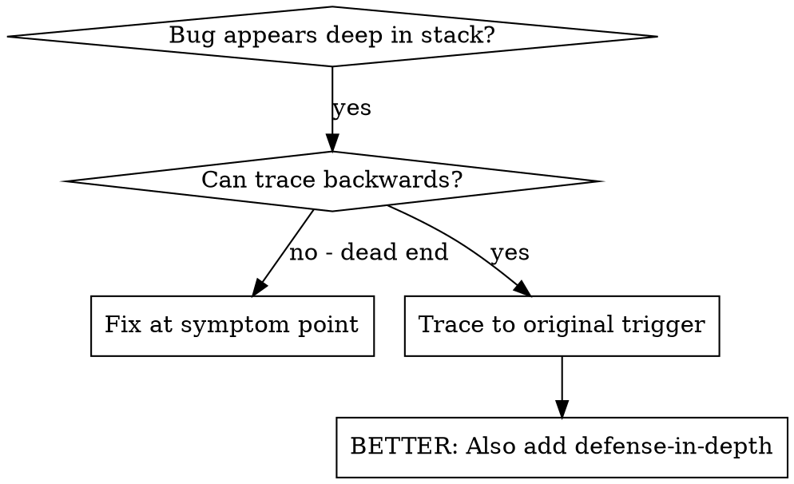
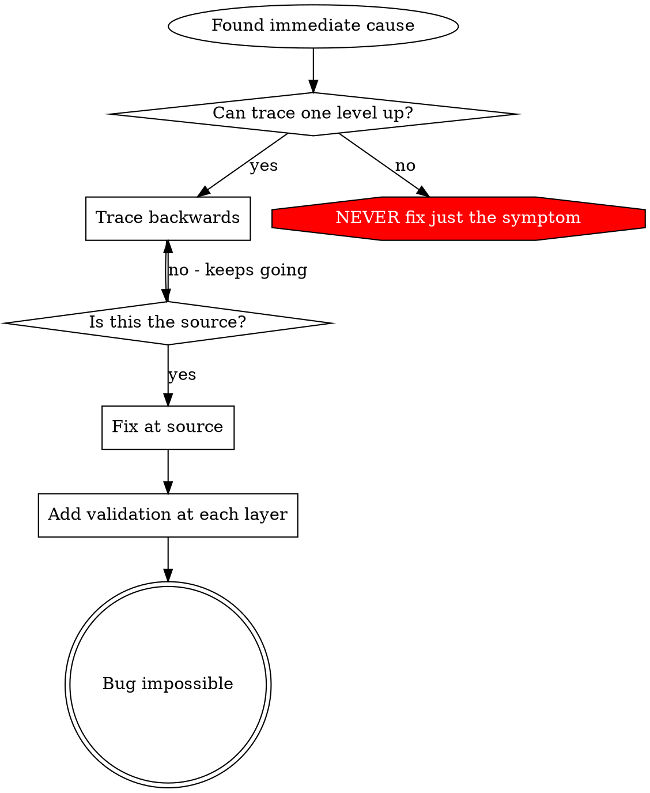

# Трассировка корневой причины

## Обзор

Ошибки часто проявляются глубоко в стеке вызовов: `git init` не в том каталоге,
файл создан не там, база данных открыта по неверному пути. Твой инстинкт — исправить
там, где видна ошибка, но это лечение симптома.

**Главный принцип:** трассируй назад по цепочке вызовов, пока не найдешь исходный
триггер, и исправляй в источнике.

## Когда использовать



**Используй, когда:**

- ошибка происходит глубоко при выполнении (не на входе);
- трассировка стека показывает длинную цепочку вызовов;
- неясно, откуда пришёл неверные данные;
- нужно найти, какой тест или код вызывает проблему.

## Процесс трассировки

### 1. Наблюдай симптом

```
Error: git init failed in ~/project/packages/core
```

### 2. Найди непосредственную причину

**Какой код напрямую это вызывает?**

```typescript
await execFileAsync('git', ['init'], { cwd: projectDir });
```

### 3. Спроси: что это вызвало?

```typescript
WorktreeManager.createSessionWorktree(projectDir, sessionId)
  → вызывается из Session.initializeWorkspace()
  → вызывается из Session.create()
  → вызывается из теста в Project.create()
```

### 4. Продолжай подниматься

**Какое значение передал?**

- `projectDir = ''` (пустая строка!)
- Пустая строка как `cwd` разрешается в `process.cwd()`
- А это каталог исходного кода!

### 5. Найди исходный триггер

**Откуда взялась пустая строка?**

```typescript
const context = setupCoreTest(); // Возвращает { tempDir: '' }
Project.create('name', context.tempDir); // Обращение до beforeEach!
```

## Как добавлять трассировки стека

Когда проследить вручную не получается, добавь инструментирование:

```typescript
// Перед проблемной операцией
async function gitInit(directory: string) {
  const stack = new Error().stack;
  console.error('DEBUG git init:', {
    directory,
    cwd: process.cwd(),
    nodeEnv: process.env.NODE_ENV,
    stack,
  });

  await execFileAsync('git', ['init'], { cwd: directory });
}
```

**Важно:** в тестах используй `console.error()`, а не журнал — журнал может не
показать вывод.

**Запусти и перехвати:**

```bash
npm test 2>&1 | grep 'DEBUG git init'
```

**Разбирай трассировки стека:**

- ищи имена файлов тестов;
- находи номер строки, вызвавшей обращение;
- выявляй закономерность (тот же тест? тот же параметр?).

## Как найти тест, вызывающий загрязнение

Если что-то появляется во время тестов, но ты не знаешь, какой тест виноват,
используй скрипт деления пополам `find-polluter.sh` из этой директории:

```bash
bash ./find-polluter.sh '.git' 'src/**/*.test.ts'
```

Скрипт запускает тесты по одному и останавливается на первом загрязнителе. Порядок
использования смотришь в самом скрипте.

## Реальный пример: пустой projectDir

**Симптом:** `.git` создан в `packages/core/` (в исходном коде)

**Цепочка трассировки:**

1. `git init` выполняется в `process.cwd()` ← пустой параметр cwd
2. WorktreeManager вызван с пустым projectDir
3. Session.create() передал пустую строку
4. Тест обратился к `context.tempDir` до beforeEach
5. setupCoreTest() изначально возвращает `{ tempDir: '' }`

**Корневая причина:** инициализация переменной верхнего уровня обращалась к пустому
значению

**Исправление:** сделал tempDir геттером, который падает при обращении до
beforeEach

**Заодно добавил защиту в глубину:**

- слой 1: Project.create() проверяет каталог;
- слой 2: WorkspaceManager проверяет, что значение не пустое;
- слой 3: проверка NODE_ENV запрещает git init вне временного каталога;
- слой 4: журналирование трассировки стека перед git init.

## Ключевой принцип



**НИКОГДА не исправляй только там, где видна ошибка.** Трассируй назад, чтобы
найти исходный триггер.

## Советы по трассировке стека

**В тестах:** используй `console.error()`, а не журнал — журнал могут подавить.
**Перед операцией:** логируй до опасной операции, а не после её сбоя.
**Включай контекст:** каталог, cwd, переменные окружения, отметки времени.
**Захватывай стек:** `new Error().stack` показывает полную цепочку вызовов.

## Реальный эффект

Из сессии отладки (2025-10-03):

- корневая причина найдена через трассировку на пять уровней;
- исправление в источнике (проверка в геттере);
- добавлено четыре слоя защиты;
- 1847 тестов прошёл, загрязнения нет.
