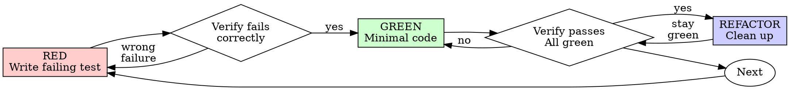

# Разработка через тестирование (TDD)

## Обзор

Сначала напиши тест. Посмотри, как он падает. Напиши минимальный код, чтобы он прошёл.

**Главный принцип:** если ты не видел, как тест падает, ты не знаешь, проверяет ли он нужное.

**Нарушение буквы правил означает нарушение их сути.**

## Когда использовать

**Всегда:**

- новые возможности
- исправление ошибок
- рефакторинг
- изменение поведения

**Исключения (спроси своего собеседника):**

- одноразовые прототипы
- сгенерированный код
- файлы конфигурации

Думаешь «пропущу TDD только в этот раз»? Остановись. Это оправдание.

## Железный закон

```
НИКАКОГО РАБОЧЕГО КОДА БЕЗ ПАДАЮЩЕГО ТЕСТА
```

Написали код раньше теста? Удали его. Начни заново.

**Без исключений:**

- не оставляй его «как образец»
- не «адаптируй» его, пока пишешь тесты
- не смотришь на него
- удалить значит удалить

Реализуй заново, исходя из тестов. Точка.

## Цикл «красный — зелёный — рефакторинг»



### КРАСНЫЙ — напиши падающий тест

Напиши один минимальный тест, показывающий, что должно происходить.

<Good>

```typescript
test('retries failed operations 3 times', async () => {
  let attempts = 0;
  const operation = () => {
    attempts++;
    if (attempts < 3) throw new Error('fail');
    return 'success';
  };

  const result = await retryOperation(operation);

  expect(result).toBe('success');
  expect(attempts).toBe(3);
});
```

Понятное имя, проверка реального поведения, одна вещь
</Good>

<Bad>

```typescript
test('retry works', async () => {
  const mock = jest.fn()
    .mockRejectedValueOnce(new Error())
    .mockRejectedValueOnce(new Error())
    .mockResolvedValueOnce('success');
  await retryOperation(mock);
  expect(mock).toHaveBeenCalledTimes(3);
});
```

Размытое имя, проверяется подделка, а не код
</Bad>

**Требования:**

- одно поведение
- понятное имя
- настоящий код (подделки — только если без них нельзя)

### Проверь КРАСНЫЙ — посмотри, как тест падает

**ОБЯЗАТЕЛЬНО. Не пропускай.**

```bash
npm test path/to/test.test.ts
```

Убедись, что:

- тест падает (а не завершается ошибкой)
- сообщение о сбое ожидаемое
- падение вызвано отсутствием возможности (а не опечаткой)

**Тест проходит?** Значит, ты проверяешь существующее поведение. Исправь тест.

**Тест завершается ошибкой?** Исправь ошибку и запускай, пока он не начнёт падать правильно.

### ЗЕЛЁНЫЙ — минимальный код

Напиши самый простой код, который проходит тест.

<Good>

```typescript
async function retryOperation<T>(fn: () => Promise<T>): Promise<T> {
  for (let i = 0; i < 3; i++) {
    try {
      return await fn();
    } catch (e) {
      if (i === 2) throw e;
    }
  }
  throw new Error('unreachable');
}
```

Ровно столько, сколько нужно для прохождения
</Good>

<Bad>

```typescript
async function retryOperation<T>(
  fn: () => Promise<T>,
  options?: {
    maxRetries?: number;
    backoff?: 'linear' | 'exponential';
    onRetry?: (attempt: number) => void;
  }
): Promise<T> {
  // YAGNI
}
```

Переусложнено
</Bad>

Не добавляй возможности, не рефакторь другой код и не «улучшай» сверх теста.

### Проверь ЗЕЛЁНЫЙ — посмотри, как тест проходит

**ОБЯЗАТЕЛЬНО.**

```bash
npm test path/to/test.test.ts
```

Убедись, что:

- тест проходит
- остальные тесты по-прежнему проходят
- вывод чистый (без ошибок и предупреждений)

**Тест падает?** Исправляй код, а не тест.

**Другие тесты падают?** Исправь сейчас.

**«Другие тесты» — это весь набор проекта, а не только твой файл.** Зелёный
прогон написанного тобой теста ещё не означает зелёный набор. Прежде чем
считать изменение готовым, запусти команду тестов проекта (`pytest`,
`npm test`, `cargo test` — то, что принято в репозитории), даже если в задаче
назван только один файл тестов. Указание области в задаче ограничивает
результат, но не твою проверку. Любой сбой из этого прогона — в том числе
тот, который вызвали не ты, — назови в отчёте по имени. Красный тест,
который ты видел в выводе и не упомянули, — это отчёт, искажённый
умолчанием.

### РЕФАКТОРИНГ — наведи порядок

Только после зелёного:

- убери дублирование
- улучши имена
- вынеси вспомогательные функции

Сохраняй тесты зелёными. Не добавляй поведение.

### Повторяй

Следующий падающий тест для следующей возможности.

## Хорошие тесты

| Качество | Хорошо | Плохо |
|---------|------|-----|
| **Минимальность** | Одна вещь. Есть «и» в имени? Раздели. | `test('validates email and domain and whitespace')` |
| **Понятность** | Имя описывает поведение | `test('test1')` |
| **Ясность замысла** | Показывает желаемый API | Скрывает, что должен делать код |

Перед написанием или изменением любого теста прочитай [writing-good-tests.md](writing-good-tests.md) — там правила, которые не дают тестам лгать:

- назови изменение в рабочем коде, из-за которого тест упадёт, — до написания теста
- проверяй настоящее поведение, а не поведение подделки
- держишь код только для тестов в тестовых утилитах, а не в рабочих классах
- понимай побочные эффекты зависимости, прежде чем её подделывать

## Частые оправдания

| Оправдание | Действительность |
|--------|---------|
| «Слишком просто, чтобы тестировать» | Простой код ломается. Тест занимает 30 секунд. |
| «Протестирую потом» | Тесты, написанные после, проходят сразу — и это ничего не доказывает. Они могут проверять не то, проверять реализацию вместо поведения или упустить крайний случай, о котором ты забыл. Ты не видел падения, значит, не доказали, что тест ловит ошибку. Тест до кода принуждает к этому падению. |
| «Тесты после дают тот же результат (важна суть, а не ритуал)» | Тесты после отвечают на вопрос «что делает этот код?», тесты до — «что он должен делать?». Тесты, написанные после, смещены уже написанным кодом: ты проверяешь случаи, которые вспомнили, а не те, которые обнаружили бы. Это покрытие без доказательства, что тесты работают. |
| «Я уже проверил вручную» | Ручная проверка бессистемна: нет записи, что именно проверено, её нельзя повторить при изменении кода, под давлением легко забыть случаи. «Работало, когда я пробовал» ≠ полная проверка. Автоматические тесты выполняются одинаково каждый раз. |
| «Удалять X часов работы — расточительство» | Это ловушка невозвратных затрат: время уже потрачено в любом случае. Реальный выбор: переписать по TDD (высокая уверенность) или оставить код и приделать тесты потом (низкая уверенность, вероятные ошибки). Расточительство — держать код, которому нельзя доверять. |
| «Оставлю как образец, а тесты напишу сначала» | Ты его адаптируешь. Это и есть тестирование после. Удалить значит удалить. |
| «Сначала нужно изучить» | Хорошо. Выбрось исследование и начни с TDD. |
| «Тест писать трудно = проектирование неясно» | Слушай тест. Трудный в тестировании код трудно использовать. |
| «TDD меня замедлит» | TDD и есть прагматичный путь: ловит ошибки до коммита, предотвращает регрессии, позволяет рефакторить без страха. «Прагматичные» обходы означают отладку в рабочей среде — медленнее, а не быстрее. |
| «Вручную проверять быстрее» | Вручную крайние случаи не докажешь. Придётся перепроверять при каждом изменении. |
| «В существующем коде нет тестов» | Ты его улучшаешь. Добавь тесты для существующего кода. |

## Тревожные сигналы — СТОП и начни заново

- код раньше теста
- тест после реализации
- тест проходит сразу
- не можешь объяснить, почему тест падал
- тесты добавлены «позже»
- оправдание «только в этот раз»
- «я уже проверил вручную»
- «тесты после дают тот же результат»
- «важна суть, а не ритуал»
- «оставлю как образец» или «адаптирую существующий код»
- «уже потрачено X часов, удалять расточительно»
- «TDD догматичен, я прагматичен»
- «здесь другой случай, потому что...»

**ВСЁ это значит: удали код. Начни заново по TDD.**

## Пример: исправление ошибки

**Ошибка:** принимается пустой адрес электронной почты

**КРАСНЫЙ**

```typescript
test('rejects empty email', async () => {
  const result = await submitForm({ email: '' });
  expect(result.error).toBe('Email required');
});
```

**Проверка КРАСНОГО**

```bash
$ npm test
FAIL: expected 'Email required', got undefined
```

**ЗЕЛЁНЫЙ**

```typescript
function submitForm(data: FormData) {
  if (!data.email?.trim()) {
    return { error: 'Email required' };
  }
  // ...
}
```

**Проверка ЗЕЛЁНОГО**

```bash
$ npm test
PASS
```

**РЕФАКТОРИНГ**

При необходимости вынеси проверку для нескольких полей.

## Контрольный список проверки

Перед тем как считать работу завершённой:

- [ ] у каждой новой функции или метода есть тест
- [ ] ты видел падение каждого теста до реализации
- [ ] каждый тест падал по ожидаемой причине (возможность отсутствовала, а не опечатка)
- [ ] написан минимальный код для прохождения каждого теста
- [ ] все тесты проходят
- [ ] вывод чистый (без ошибок и предупреждений)
- [ ] тесты используют настоящий код (подделки только при необходимости)
- [ ] крайние случаи и ошибки покрыты

Не все пункты отмечены? Ты пропустил TDD. Начни заново.

## Когда застрял

| Проблема | Решение |
|---------|----------|
| Не знаю, как тестировать | Напиши желаемый API. Сначала напиши проверку. Спроси собеседника. |
| Тест слишком сложный | Проектирование слишком сложное. Упрости интерфейс. |
| Приходится подделывать всё | Код слишком связан. Используй внедрение зависимостей. |
| Подготовка теста огромная | Вынеси вспомогательные функции. Всё ещё сложно? Упрости проектирование. |

## Связь с отладкой

Нашёл ошибку? Напиши падающий тест, который её воспроизводит. Пройди цикл TDD. Тест докажет исправление и предотвратит регрессию.

Никогда не исправляй ошибки без теста.

## Итоговое правило

```
Рабочий код → тест существует и упал первым
Иначе → это не TDD
```

Исключений без разрешения собеседника нет.
