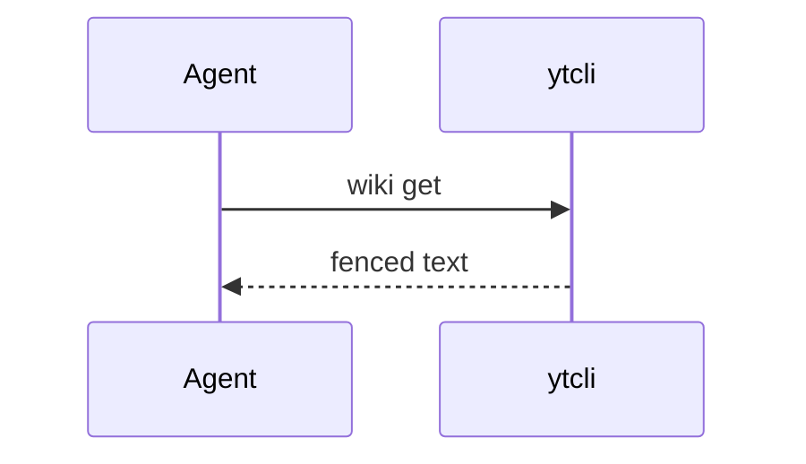

# Вики-страница, где использована вся разметка

Исходник демонстрационной страницы, собранной через `ytcli wiki create` и проверенной в браузере на настоящей Yandex Wiki, конструкция за конструкцией. Всё здесь отрисовалось. Копируй конструкцию отсюда, а не угадывай: документация самой Wiki про часть из них рассказывает, но не показывает, а неудачные догадки (сноски, `[TOC]`, голый `[] пункт`) перечислены в `wiki.md`.

Страница — это Markdown с расширениями Wiki. Визуальный редактор переписывает то, что сохраняет: экранирует незнакомый синтаксис и переформатирует таблицы. Поэтому это форма для записи, а не обязательно та форма, которую прочитаешь после того, как кто-то поправит страницу в браузере.

````markdown
# Витрина {#top}



## Стили текста

**Жирный**, _курсив_, ++подчёркнутый++, ~~зачёркнутый~~, ##моноширинный##,
`инлайн-код`, ==выделение==, E=mc^2^, H~2~O.

{red}(Красный), {green}(зелёный), {blue}(синий), {gray}(серый), {yellow}(жёлтый),
{orange}(оранжевый), {violet}(фиолетовый).

Эмодзи :smile: :rocket: и упоминание @login.

---

## Списки

1. Первый
2. Второй
   1. Вложенный нумерованный
3. Третий

- Маркированный
  - Вложенный маркированный

[ ] Открытый пункт чек-листа

[X] Выполненный пункт чек-листа

- [ ] Открытый пункт списка задач
- [x] Выполненный пункт списка задач

## Цитата

> Цитата.
>
> > Цитата внутри неё.

## Ссылки и якоря

[Внешняя ссылка](https://yandex.ru), [вики-страница](/users/login),
[якорь на этой странице](#top), голый адрес: https://tracker.yandex.ru

Инлайн-якорь с подсказкой: #[здесь](here "Что отмечает якорь")

## Трекер

Ключ задачи сам по себе становится живой карточкой: QUEUE-1

Адрес задачи тоже: https://tracker.yandex.ru/QUEUE-2

Задачи очереди, не более 50 (адрес фильтра тоже подходит):



## Код

```bash
ytcli wiki get users/login/showcase
```

## Формулы

Инлайн: $E = mc^2$

$$
\sum_{i=1}^{n} i = \frac{n(n+1)}{2}
$$

## Таблицы

| Markdown | таблица |
|---|---|
| ячейка **жирным** | ячейка `кодом` |

#|
|| Многострочная | таблица ||
||

- список
- в ячейке

|

```
код в ячейке
```

||
|#

## Блоки



Заметка: типы — info, tip, warning и alert.





Скрыто до раскрытия.





- Первая вкладка

  Содержимое первой вкладки.

- Вторая вкладка

  Содержимое второй вкладки.



## Диаграммы





@startuml
ytcli -> Wiki : GET /v1/pages
@enduml



Диаграмма draw.io рисуется в редакторе и сохраняется с картинкой внутри;
`wiki get` показывает нагрузку её размером, если не передан `--full`:



## Встроенное содержимое

/iframe/(src="https://yandex.ru/map-widget/v1/?ll=37.588144%2C55.733842&z=16" width="600" height="300" frameborder="0" scrolling="no")

/iframe/(src="https://www.youtube.com/embed/oCRQj_zyPjk" width="560" height="315" frameborder="0" scrolling="no")


Файл, приложенный к этой странице: [notes.txt](/users/login/showcase/.files/notes.txt)

## Динамическая таблица


````

Таблица, созданная через `wiki create-grid`, остаётся лишь ресурсом страницы, пока строка `wgrid` не вставит её в текст. У той, что на витрине, была колонка каждого типа — текст, число, дата, флажок, список, человек, задача Трекера и статус задачи, — заполненная через `wiki columns-add` и `wiki rows-add`; колонка статуса задачи заполняется сама из Трекера. Широкая таблица в браузере прокручивается вбок, а не переносится.
